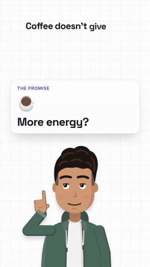
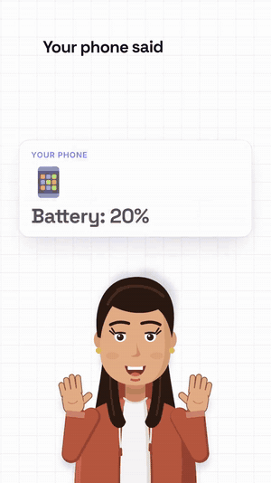
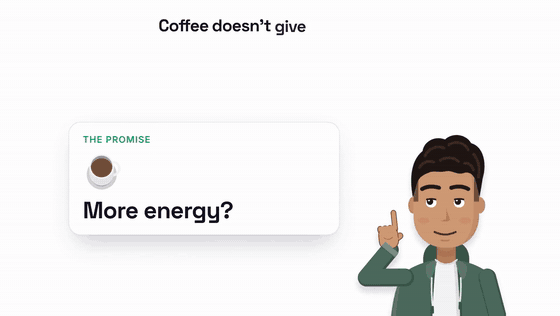

# beatreel

Make explainer videos from a JSON script, vertical (1080×1920) or wide (1920×1080), 30 fps. You write the lines; beatreel speaks them,
puts the words on screen as they are said, and gives every idea its own animated scene, with a talking presenter
at the bottom.

```
script.json  →  voice (Kokoro, offline)  →  word timings  →  HTML + GSAP page  →  HyperFrames render  →  mix  →  video.mp4
```

It runs entirely on your machine. No accounts, no API keys, no cloud voice.

<table>
<tr>
<td align="center"><a href="docs/coffee.mp4"></a><br><sub>9:16 · Kai · grid</sub></td>
<td align="center"><a href="docs/cold-battery.mp4"></a><br><sub>9:16 · Maya · female voice</sub></td>
</tr>
<tr>
<td colspan="2" align="center"><a href="docs/coffee-16x9.mp4"></a><br><sub>16:9 · plain background · custom accent</sub></td>
</tr>
</table>

The GIFs are silent 9-second previews; click one for the full video with voice, sound effects and music. A
catalogue of every scene: [docs/tour.mp4](docs/tour.mp4).

## What it has

- **A voice**: [Kokoro](https://huggingface.co/hexgrad/Kokoro-82M), 50+ stock voices, with a pronunciation
  checker that lists every word it had to guess (`./beatreel say "..."`), so names, acronyms and prices
  come out right.
- **Word-synced captions**: each word pops in as it is spoken, key words (`_like this_`) get a highlight.
- **One idea per beat, cut into shots**: about 60 animated scenes (cards, numbers that roll, terminals that type, checklists that
  tick, code that scrolls, charts, gauges, a world map, dominoes, status boards, file conversions, star bursts,
  follow cards ...). Every piece lands on the word that names it (`"at": "word:checklist"`), entrances vary
  from shot to shot, impacts shake the frame and throw sparks, and every scene is scaled to fit the frame.
- **Two presenters drawn in code**: Kai and Maya (`"character": "maya"`), on screen the whole video: lip movement on every word, blinks,
  25+ poses and moods (`docs/kai-poses.jpg`), and he moves between left, centre and right along the bottom.
  Recolour them, ask your coding agent to draw a new presenter on the same rig (SKILL.md, "Make your own
  presenter"), plug in your own character video, or leave the presenter out.
- **Sound effects built in**: 12 short code-made sounds (pops, ticks, a whoosh, an impact, typing, chimes) in
  `engine/sfx/`, placed on every entrance, tick and impact. `"sfx": false` turns them off.
- **Two formats**: `"format": "9:16"` (default, Reels/Shorts/TikTok) or `"16:9"` (YouTube): caption on top,
  scenes on the left, the presenter bottom right.
- **Background and colours**: `"bg": "grid"` (default, a faint grid on white) or `"plain"`, and any colours you
  like with `"colors": {"accent": "#0e9f6e", "bg": "#fffaf2"}`. Themes: `studio` (light, default), `night`
  (dark), `paper`.
- **Optional extras**: a quiet code-made music bed (`"music": {"style": "soft"}`), any of earshot's 250+
  sounds through [earshot](https://github.com/Leonxlnx/earshot) (`"sfx_id"` on a scene), your own intro sound, pre-rendered clips with
  transparency (for example 3D shots).
- **A frames sheet** before the full render (`board`), so you can check every beat in one picture.

## What it doesn't have

- No timeline editor or GUI: the script is the edit.
- No AI script writing or research: you (or your coding agent) write the lines.
- No stock footage or image generation: it animates what you give it.
- No voice cloning, and no cloud TTS.
- No auto-posting to Instagram, TikTok or YouTube.
- Two sizes only: 1080×1920 and 1920×1080.

## Install

Needs Python 3.10-3.13, Node 18+ and ffmpeg. On a Mac: `brew install python@3.12 node ffmpeg` (the `python3`
that ships with macOS is 3.9, which is too old; setup finds the newer one by itself).

```bash
git clone https://github.com/anand-reddi/beatreel && cd beatreel
bash setup.sh            # .venv with the python packages, voice model (~340 MB), gsap, icons, headless Chrome
bash setup.sh --sfx      # optional: also install earshot for sound effects
```

`./beatreel ...` runs with the Python that setup installed. HyperFrames renders through a headless Chrome; setup
installs one with Playwright, or point `HYPERFRAMES_BROWSER_PATH` at your own.

## Use it with an AI agent

Paste the repo link into Claude Code or Codex CLI and ask for a video ("make a 30 second video about how
vaccines work"). The agent clones the repo, reads [AGENTS.md](AGENTS.md) (the steps: setup, research, script,
pronunciation check, render, frame check) and hands you the mp4. It needs to run on a machine with internet for
the first setup; chat-only assistants and offline sandboxes can write the script but not render it.

To have it as a Claude Code skill in every project:

```bash
git clone https://github.com/anand-reddi/beatreel ~/.claude/skills/beatreel && bash ~/.claude/skills/beatreel/setup.sh
```

Then ask Claude Code for a video anywhere; it finds the skill by its description.

## Make your first video

```bash
./beatreel board examples/coffee/coffee.json   # voice + a frames sheet: examples/coffee/coffee-frames.jpg
./beatreel make  examples/coffee/coffee.json   # the video: examples/coffee/coffee.mp4
```

A script is a list of beats. Each beat has the lines it says and the scene that shows them:

```json
{
 "name": "coffee",
 "theme": "studio",
 "beats": [
  {"pose": "point_up",
   "lines": ["Coffee doesn't give you energy.", "It _hides_ how tired you are."],
   "shots": [
    {"type": "card", "icon": "fluent-emoji-flat:hot-beverage", "title": "Energy?"},
    {"type": "sticker", "lines": ["IT HIDES", "THE TIRED"], "red": true, "at": "word:hides"}
   ]},
  {"pose": "count",
   "lines": ["About half of it is still in you five hours later."],
   "hero": {"type": "num", "value": 5, "suffix": " hrs", "label": "time to clear half the caffeine", "at": "word:five"}}
 ]
}
```

`hero` is one scene (or a list shown together) for the whole beat; `shots` is a list of scenes that cut from one to
the next, each starting on its `at`. The full reference (every scene type and key) is in [SKILL.md](SKILL.md).

## Examples

| | |
|---|---|
| `examples/coffee/` | 21 s, two shots per beat, Kai on every frame, sound effects |
| `examples/coffee/coffee-16x9.json` | the same script as a 16:9 video, plain background, green accent |
| `examples/cold-battery/` | 23 s, Maya with a female voice (`af_heart`) and the music bed |
| `examples/tour/` | 34 s, no presenter, one beat per scene type: a quick catalogue of what the engine draws |

## Voice

```json
"voice": {"name": "af_heart", "speed": 1.1, "say": {"SQL": "sequel", "Nguyen": "/wˈɪn/"}}
```

By default Kai speaks with `am_michael` and Maya with `af_heart`. `name` is any Kokoro voice: American `af_heart`, `af_bella`, `af_nicole`, `am_michael`, `am_fenrir` ...,
British `bf_emma`, `bm_george` ... (the full list is on the
[Kokoro model card](https://huggingface.co/hexgrad/Kokoro-82M/blob/main/VOICES.md)). `say` fixes a word for this
script, either as plain respelling or as phonemes between slashes; `core/lexicon.json` holds fixes for every script.
After each run, `build/<name>/pronounce.txt` lists every word the voice guessed.

The voice reads whole sentences in one breath (so the tone runs on naturally across caption lines) at a
short-form pace, about 185-200 words a minute: `speed` 1.1 by default (1.15 for `am_michael`, who reads slower;
1.0 is audiobook pace, 1.2 is fast). Pauses are short: 0.2 s before a new
beat and 0.09 s between sentences; change them with `gap_beat` and `gap_line`. `core/lexicon.json` already knows
about 80 brand and tech names (NVIDIA, GitHub, ChatGPT, DeepSeek, macOS, Kubernetes, ...).

Writing tips that make it sound like a person: short sentences (8-14 words), contractions ("it's", "you'll"),
numbers written the way you'd say them ("about half", "five hours"), and a comma where you'd take a breath.

## Format and look

```json
"format": "16:9", "bg": "plain", "colors": {"accent": "#0e9f6e", "hi": "#f59e0b", "bg": "#ffffff", "ink": "#14142b"}
```

`format` is `"9:16"` (default) or `"16:9"`. `bg` is `"grid"` (default) or `"plain"`. `colors` sets any theme variable:
`accent` (highlights, buttons, stamps), `hi` (second colour), `bg`, `ink` (text), `card`, `bad` (alarms). For a
whole new look, copy the `#stage.t-studio` block at the end of `engine/style.css`, change it, and use
`"theme": "yourname"`.

## Presenter

- Kai (default) or Maya (`"character": "maya"`, the same poses and moods, long hair, her own palette): `"pose"` per beat, `"kai": "left" | "center" | "right"` per beat (otherwise he moves on his
  own; `"presenter_move": false` keeps him centred), `"avatar_colors": {"shirt": "#2d4f8a", "hair": "#5a3a22", ...}` to recolour,
  `"presenter": false` on a beat to hide him for it, `"character": "none"` to leave him out entirely.
- Your own character: `"character": "path/to/folder"` with a `character.json` and one transparent video holding a
  short clip per pose:

```json
{"file": "me.webm", "canvas": [1800, 1080], "head_x": 0.5, "head_y": 0.31, "default": "talk",
 "clips": {"talk": [0.0, 2.0], "point_up": [2.0, 3.5], "shrug": [3.5, 5.0]}, "aliases": {"explain": "talk"}}
```

## Licence

MIT for beatreel's own code, see [LICENSE](LICENSE). The fonts in `engine/fonts/` are SIL OFL 1.1, and the voice
model, GSAP, HyperFrames and the icon sets are installed from their own projects under their own licences; see
[THIRD_PARTY_NOTICES.md](THIRD_PARTY_NOTICES.md).
